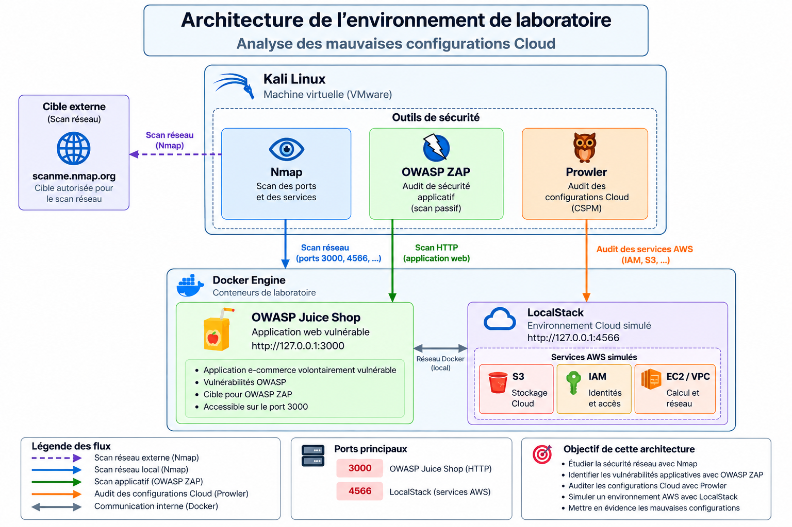
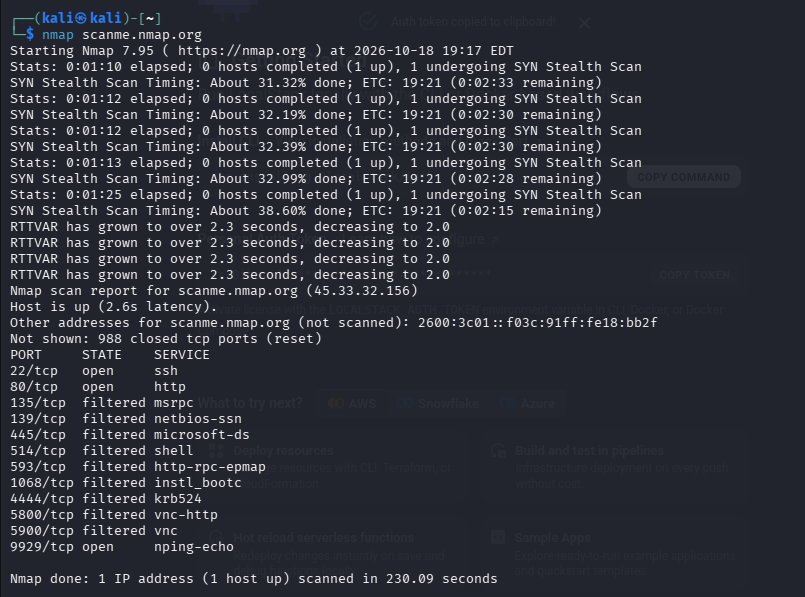
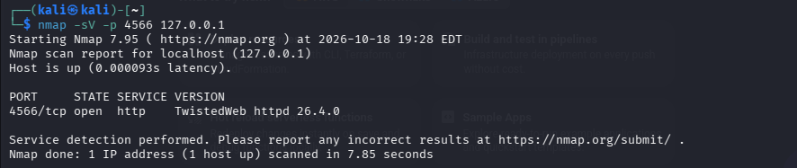
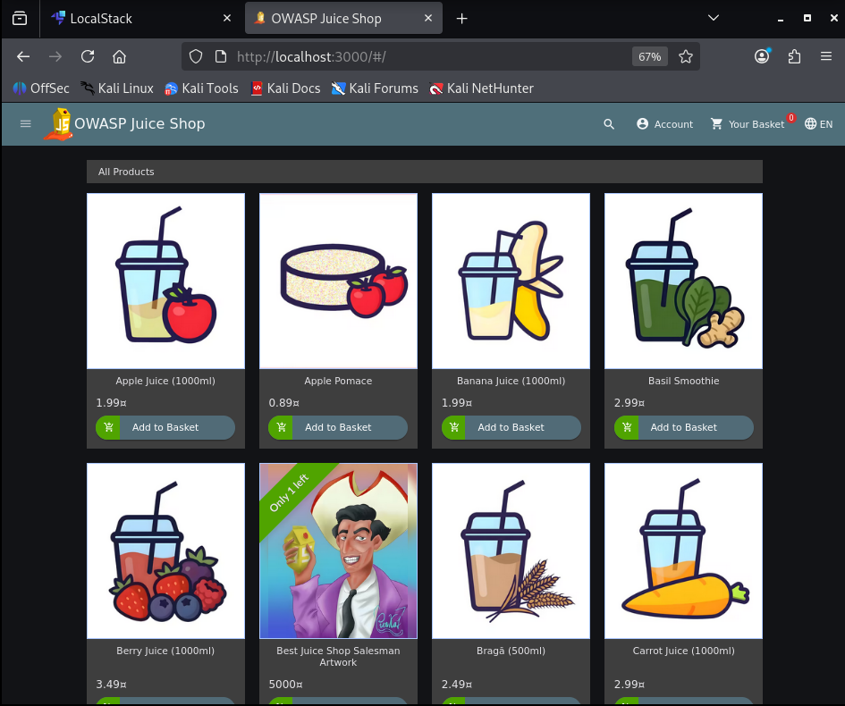
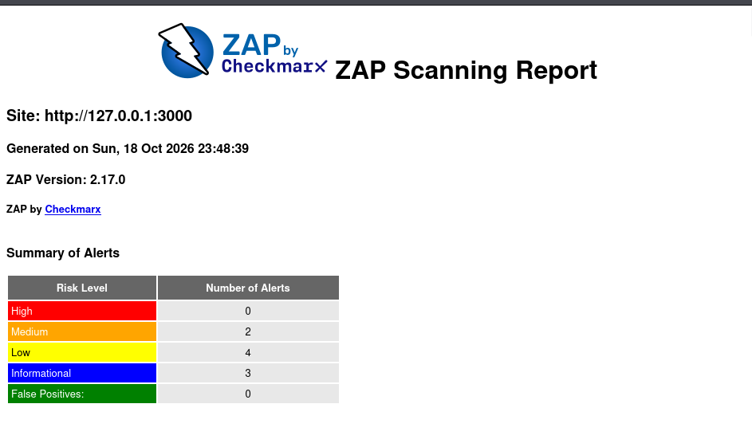
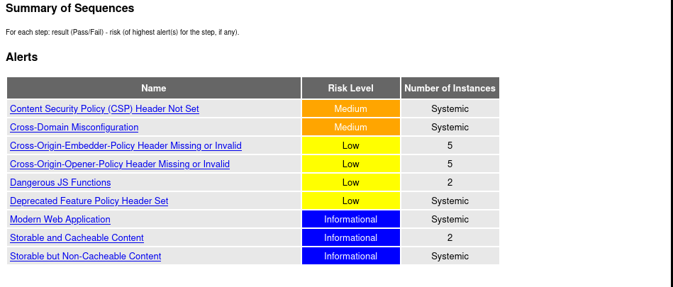
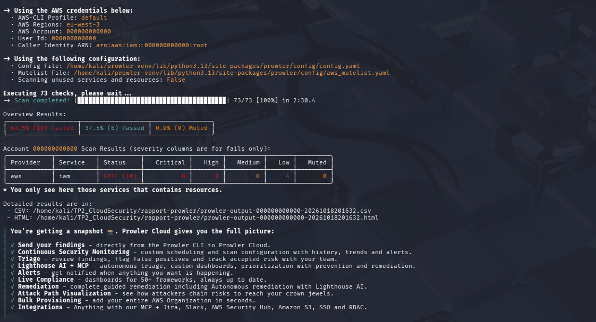
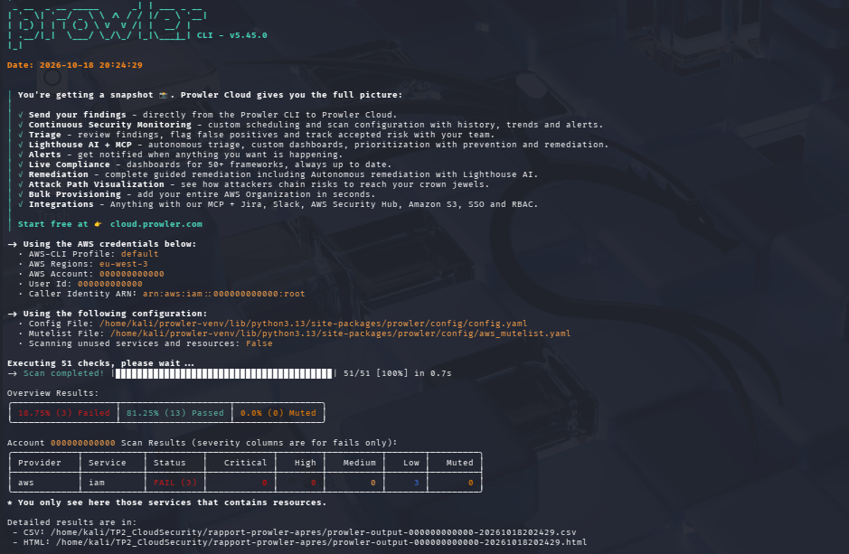
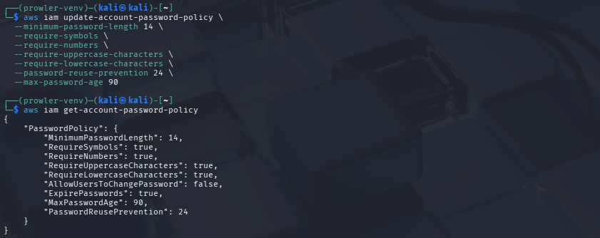

# Audit d’exposition réseau et de posture de sécurité Cloud

> **Laboratoire pratique — Nmap · OWASP ZAP · Prowler · Docker · LocalStack · Kali Linux**  
> Évaluation multi-couches : exposition des services, sécurité applicative, configuration des identités et remédiation.



## Résumé exécutif

Ce projet documente un audit technique **autorisé**, mené sur une machine virtuelle **Kali Linux (VMware)**. Les tests ont porté sur une cible publique explicitement mise à disposition pour Nmap (`scanme.nmap.org`) et deux services locaux isolés : **OWASP Juice Shop** et **LocalStack**. L'objectif est de rapprocher les observations d'exposition réseau (Nmap), les alertes de configuration d'application web (OWASP ZAP) et les écarts de configuration Cloud (Prowler), puis de mesurer l'effet d'une remédiation IAM.

### Indicateurs clés

| Domaine | Résultat observé | Portée / précaution |
|---|---|---|
| Nmap — cible autorisée | 22/tcp (SSH), 80/tcp (HTTP), 9929/tcp (nping-echo) ouverts | Instantané du serveur public de démonstration, pas une vulnérabilité prouvée |
| Nmap — laboratoire local | 3000/tcp (Juice Shop), 4566/tcp (LocalStack) ouverts | Services liés à `127.0.0.1` sur la VM |
| OWASP ZAP 2.17.0 | 9 catégories : **0 élevées, 2 moyennes, 4 faibles, 3 informatives** | Baseline scan passif ; alerte ≠ preuve d'exploitation |
| Prowler 5.45.0 — avant | **6 PASS / 10 FAIL** (16 findings) | Contrôles IAM ; 73 checks exécutés, pas 73 findings |
| Prowler — après remédiation | **13 PASS / 3 FAIL** (16 findings) | Second audit IAM ciblé ; 51 checks exécutés |
| Mesure corrective vérifiée | Politique de mots de passe IAM : 14 caractères, complexité, historique 24, expiration 90 j | Configuration du lab conforme aux checks évalués, pas une règle universelle de production |

**Amélioration mesurée** : le taux de succès des 16 résultats IAM comparables passe de **37,5 % à 81,25 %** (+43,75 points). Les contrôles FAIL passent de 10 à 3. Le périmètre de vérifications n'est pas identique entre les deux exécutions (S3 + IAM initialement, IAM seul ensuite) : il ne faut donc pas interpréter ces scores comme une mesure de sécurité globale AWS.

## 1. Architecture et périmètre

| Composant | Usage | Endpoint / infrastructure |
|---|---|---|
| VMware + Kali Linux | Poste d'audit | VM locale |
| Docker Engine | Isolation des cibles de laboratoire | Conteneurs locaux |
| OWASP Juice Shop | Application volontairement vulnérable | `http://127.0.0.1:3000` |
| LocalStack | Simulation des API AWS | `http://127.0.0.1:4566` |
| Nmap | Inventaire d'exposition TCP et versions | `scanme.nmap.org`, `localhost` |
| OWASP ZAP | Audit passif HTTP de Juice Shop | Baseline scan |
| Prowler | Contrôles de posture Cloud | API LocalStack (IAM, S3 demandé) |

Les ports `3000` et `4566` étaient publiés en loopback (`127.0.0.1`) d'après `ss`/Docker : cela **ne démontre pas** une exposition Internet. Le diagramme illustre des flux d'audit logiques ; il ne faut pas interpréter la proximité des conteneurs comme une communication applicative directe entre Juice Shop et LocalStack.

## 2. Reconnaissance réseau — Nmap

## Captures clés — reconnaissance et exposition

| Scan externe et versions | Port local LocalStack |
|---|---|
|  |  |
| [Scan détaillé des services](evidence/01-nmap/06-nmap-scan-versions-externe.png) | [Processus et ports d'écoute](evidence/01-nmap/14-ss-ports-et-processus.png) |


### 2.1 Cible publique autorisée

```bash
nmap scanme.nmap.org
nmap -sV -p 22,80,9929 scanme.nmap.org
```

Le premier scan a indiqué **988 ports TCP fermés**, plusieurs ports filtrés (notamment 135, 139, 445, 514, 593, 1068, 4444, 5800, 5900) et **3 ports ouverts**. Le scan ciblé a identifié :

| Port | État | Détection | Lecture sécurité |
|---|---|---|---|
| 22/tcp | open | OpenSSH 6.6.1p1 Ubuntu 2ubuntu2.13 | Administration SSH : restreindre l'accès et appliquer le durcissement approprié ; version détectée ≠ exploitabilité confirmée |
| 80/tcp | open | Apache httpd 2.4.7 (Ubuntu) | Service HTTP publié intentionnellement ; contrôler les configurations et l'usage de TLS selon le besoin |
| 9929/tcp | open | Nping echo | Service de diagnostic : désactiver sur une infrastructure réelle s'il n'est pas nécessaire |

**Limite :** les bannières/version probes donnent des signatures estimées. Aucune vulnérabilité CVE n'est ici validée, et les services ne doivent pas être attaqués au-delà du cadre autorisé.

### 2.2 Inventaire du poste Kali

```bash
nmap -sV localhost
nmap -sV -p 3000,4566 127.0.0.1
sudo ss -tulnp
ps -p 28578 -o pid,comm,args
ps -p 36583 -o pid,comm,args
ps -p 968 -o pid,comm,args
```

Le scan Nmap par défaut de `localhost` ne relevait pas les ports publiés, car ces ports ne figurent pas nécessairement dans les **1 000 ports fréquemment sondés**. Le scan explicite a trouvé **3000/tcp ouvert** (signature HTTP non reconnue, réponses de Juice Shop visibles) et **4566/tcp ouvert**, identifié comme `TwistedWeb httpd 26.4.0`.

La commande `ss` a montré :

| Adresse locale | Processus | PID capturé | Interprétation |
|---|---|---:|---|
| `127.0.0.1:4566` | `docker-proxy` | 28578 | API LocalStack |
| `127.0.0.1:3000` | `docker-proxy` | 36583 | Juice Shop |
| `127.0.0.1:34431` | `containerd` | 968 | Service interne du moteur de conteneurs |

Les PID sont **des valeurs de la session observée** et changent selon le redémarrage. L'existence d'un port à l'écoute ne suffit pas à inférer une vulnérabilité.

### 2.3 Recommandations d'exposition

- Conserver LocalStack et Juice Shop liés à `127.0.0.1` dans le laboratoire ; éviter les ports hôtes publiés sur `0.0.0.0`.
- Fermer les services inutiles et contrôler les flux via pare-feu / security groups dans des environnements réels.
- Réserver SSH à des accès administratifs authentifiés et surveillés.
- Ne jamais exposer les API de laboratoire ou des applications volontairement vulnérables sur Internet.

## 3. Sécurité applicative — OWASP ZAP

### Captures de l'audit applicatif

| Application Juice Shop | Synthèse ZAP |
|---|---|
|  |  |




**Cible :** Juice Shop (`127.0.0.1:3000`) · **ZAP :** 2.17.0 · **Mode :** baseline/passif · **Date du rapport :** 18/10/2026.

```bash
sudo docker run -d --name juice-shop -p 127.0.0.1:3000:3000 bkimminich/juice-shop
mkdir -p ~/TP2_CloudSecurity/rapport-zap
sudo docker run --rm -t --network host \
  -v "$HOME/TP2_CloudSecurity/rapport-zap:/zap/wrk:rw" \
  ghcr.io/zaproxy/zaproxy:stable zap-baseline.py \
  -t http://127.0.0.1:3000 -r rapport-zap.html
```

Le rapport recensait **9 catégories** d'alertes (pas 9 vulnérabilités confirmées). Les observations étaient :

| Alerte | Niveau ZAP | Indice observé | Mesure recommandée |
|---|---|---|---|
| Content Security Policy (CSP) Header Not Set | Moyen | En-tête CSP absent | Définir/tester une CSP restrictive et adaptée aux ressources |
| Cross-Domain Misconfiguration | Moyen | `Access-Control-Allow-Origin: *` sur des réponses | Limiter les origines lorsque les ressources nécessitent une restriction ; vérifier les données réellement exposées |
| Cross-Origin-Embedder-Policy Header Missing or Invalid | Faible | COEP absent/invalide sur 5 instances | Définir `Cross-Origin-Embedder-Policy` si compatible avec les besoins |
| Cross-Origin-Opener-Policy Header Missing or Invalid | Faible | COOP absent/invalide sur 5 instances | Envisager `same-origin` pour isoler les contextes de navigation |
| Dangerous JS Functions | Faible | `bypassSecurityTrustHtml(` dans 2 scripts | Contrôler les données insérées et éviter tout contournement non nécessaire de la sanitisation Angular |
| Deprecated Feature Policy Header Set | Faible | En-tête `Feature-Policy` | Migrer vers `Permissions-Policy` |
| Modern Web Application | Informatif | Application client JavaScript | Aucun correctif intrinsèque ; exploration adaptée (client spider) si autorisée |
| Storable and Cacheable Content | Informatif | Réponses potentiellement conservées en cache | Contrôler `Cache-Control` pour les données sensibles |
| Storable but Non-Cacheable Content | Informatif | Directives de cache avec revalidation | Vérifier l'absence de données sensibles et les règles de cache |

**Qualité des résultats :** le rapport indiquait des erreurs réseau et des réponses 4xx ; la couverture d'un baseline scan reste partielle. L'absence d'alerte de sévérité élevée **ne prouve pas** l'absence de vulnérabilités critiques (XSS, SQLi, SSRF, etc.).

## 4. Posture Cloud — Prowler / IAM

### Éléments de preuve — audit et remédiation

| Avant correction — 10 FAIL | Après correction — 3 FAIL |
|---|---|
|  |  |




### 4.1 Contexte

Prowler **5.45.0** a audité le **compte simulé `000000000000`** en `eu-west-3`. Les endpoints Python `sts`, `s3` et `iam` ont été vérifiés comme dirigés vers `http://127.0.0.1:4566` dans l'environnement virtuel. Aucun compte AWS de production n'a été utilisé.

```bash
source ~/prowler-venv/bin/activate
export AWS_ACCESS_KEY_ID=test AWS_SECRET_ACCESS_KEY=test
export AWS_DEFAULT_REGION=eu-west-3
export AWS_EC2_METADATA_DISABLED=true
export AWS_ENDPOINT_URL=http://127.0.0.1:4566
export AWS_ENDPOINT_URL_S3=http://127.0.0.1:4566
prowler aws --service s3 iam --region eu-west-3 \
  --output-formats html csv \
  --output-directory ~/TP2_CloudSecurity/rapport-prowler
```

### 4.2 Résultats initiaux IAM

**73 checks lancés, 16 findings** : 10 FAIL (6 *medium*, 4 *low*) et 6 PASS. Les résultats remontés concernaient IAM ; **aucun finding S3 n'a été montré**. Cela n'autorise pas à qualifier le stockage S3 de sûr ou d'audité exhaustivement.

| Check en échec | Sévérité | Interprétation |
|---|---|---|
| `iam_support_role_created` | Faible | Aucun rôle avec `AWSSupportAccess` |
| `iam_securityaudit_role_created` | Faible | Aucun rôle avec `SecurityAudit` |
| `iam_password_policy_expires_passwords_within_90_days_or_less` | Moyenne | Expiration non définie |
| `iam_password_policy_reuse_24` | Moyenne | Historique de 24 mots de passe non imposé |
| `iam_password_policy_lowercase` | Faible | Minuscules non requises |
| `iam_password_policy_number` | Moyenne | Chiffres non requis |
| `iam_password_policy_symbol` | Moyenne | Symboles non requis |
| `iam_password_policy_uppercase` | Moyenne | Majuscules non requises |
| `iam_password_policy_minimum_length_14` | Moyenne | Minimum de 14 caractères non imposé |
| `iam_check_saml_providers_sts` | Faible | Aucun fournisseur SAML enregistré |

Les **six checks PASS** concernaient l'usage récent du compte root, l'absence ou l'ancienneté des clés d'accès et l'absence de rattachement de la politique `AWSCloudShellFullAccess`. Ces résultats reflètent les données de LocalStack, pas un compte AWS réel.

### 4.3 Remédiation et deuxième mesure

La consultation initiale `aws iam get-account-password-policy` renvoyait `NoSuchEntity` : **aucune politique explicite** n'était configurée. Une politique a ensuite été appliquée dans LocalStack :

```bash
aws iam update-account-password-policy \
  --minimum-password-length 14 \
  --require-symbols --require-numbers \
  --require-uppercase-characters --require-lowercase-characters \
  --password-reuse-prevention 24 \
  --max-password-age 90
aws iam get-account-password-policy
```

La réponse AWS CLI confirmait les paramètres. Le second audit IAM a exécuté **51 checks** et généré **16 findings** : **13 PASS / 3 FAIL**, tous les échecs restants étant de sévérité faible. Les **sept contrôles de politique de mots de passe** précédemment en échec ne figurent plus parmi les FAIL, ce qui est cohérent avec l'amélioration observée.

| Résultats IAM | Avant | Après |
|---|---:|---:|
| PASS | 6 | 13 |
| FAIL | 10 | 3 |
| Taux PASS | 37,5 % | 81,25 % |
| FAIL moyens | 6 | 0 |
| FAIL faibles | 4 | 3 |

**Trois FAIL restants :** vraisemblablement les rôles support/audit et l'absence de SAML, d'après l'audit précédent ; **à confirmer sur le HTML post-remédiation**. Ces rôles et SAML dépendent des besoins ; il ne faut pas les créer systématiquement uniquement pour obtenir un score de 100 %.

**Remarque de gouvernance :** les règles sur la rotation/complexité proviennent des *checks* Prowler du laboratoire. En production, définir la stratégie de mots de passe selon la politique de l'organisation et les recommandations applicables (dont MFA, résistance au phishing, mots de passe uniques).

## 5. Analyse du scénario de compromission (étude théorique)

**Ce scénario a été analysé, non reproduit.** Une application accepte une URL sans validation ; une attaque SSRF conduit au service de métadonnées, expose potentiellement des identifiants Cloud temporaires ; des autorisations trop larges et un bucket S3 public facilitent l'accès aux sauvegardes.

| Étape | Menace | Responsable principal | Prévention / détection |
|---|---|---|---|
| 1 | Validation insuffisante des URL, WAF absent | Client (application) | Liste d'URL/destinations autorisées, segmentation et WAF en défense complémentaire ; tests applicatifs |
| 2 | SSRF vers métadonnées d'instance | Client (instance/application) | IMDSv2 si EC2 réel, filtrage des destinations internes, validation des redirections |
| 3 | Accès à des identifiants temporaires | Client (IAM/instance) | Moindre privilège, rôles limités et journalisation ; analyse des accès inhabituels |
| 4 | Bucket S3 exposé publiquement | Client (S3) | S3 Block Public Access, policies restrictives et contrôles CSPM |
| 5 | Téléchargement des sauvegardes | Client (données) | Supervision des événements d'accès, alertes d'exfiltration et chiffrement |

**Couverture des outils :** Nmap détecte les ports exposés, ZAP signale des indices de faiblesse applicative mais son *baseline scan* ne démontre pas une SSRF, et Prowler peut signaler des configurations Cloud risquées sous réserve de prise en charge des API auditées.

## 6. Limites et éthique

1. **Cibles autorisées seulement** : `scanme.nmap.org`, Juice Shop et LocalStack locaux ; aucune exploitation de cible tierce.
2. **LocalStack simule AWS** : certaines API, réactions et garanties ne reproduisent pas intégralement un environnement réel.
3. **Exposition locale ≠ exposition publique** : ports Docker publiés uniquement sur loopback.
4. **ZAP baseline = tests passifs** : les alertes doivent être priorisées/validées manuellement ; pas de preuve d'exploitation.
5. **Findings ≠ checks exécutés** : 73/51 checks Prowler donnent 16 findings observables chacun ; pas de taux de réussite sur l'ensemble des checks.
6. **Posture S3 non conclue** : pas de findings S3 dans les résultats partagés.
7. **Ne jamais publier** de jeton LocalStack, de vraies clés AWS, de fichiers `.env`, de données sensibles ni de journaux contenant des secrets.

## 7. Preuves et reproductibilité

Les 35 captures fournies sont **renommées avec des noms descriptifs**, sans modification de leur contenu, dans [`evidence/`](evidence/). Voir le [catalogue de preuves](docs/CAPTURES.md) pour leur correspondance avec les manipulations. Certains écrans sont des étapes d'installation ou de dépannage ; ils servent à documenter le processus, pas à prouver à eux seuls un finding.

**Pour refaire le lab :** disposer de Kali Linux, Docker, AWS CLI v2, LocalStack et un compte/jeton autorisé, Nmap, OWASP ZAP Docker et Prowler dans un `venv`. Toujours valider le endpoint `127.0.0.1:4566` avant d'exécuter une commande AWS CLI ou Prowler.

## Structure du dépôt

```text
cloud-security-exposure-posture-audit/
├── README.md
├── assets/architecture-laboratoire.png
├── docs/
│   ├── CAPTURES.md
│   └── METHODOLOGIE.md
├── evidence/
│   ├── 01-nmap/
│   ├── 02-zap/
│   └── 03-prowler/
└── .gitignore
```

## Références

- [Nmap — Documentation](https://nmap.org/book/man.html)
- [OWASP ZAP — Documentation](https://www.zaproxy.org/docs/)
- [OWASP Juice Shop](https://owasp.org/www-project-juice-shop/)
- [Prowler — Documentation](https://docs.prowler.com/)
- [LocalStack — Documentation](https://docs.localstack.cloud/)
- [AWS Shared Responsibility Model](https://aws.amazon.com/compliance/shared-responsibility-model/)

---

*Projet pédagogique de sécurité Cloud et applicative. Les mesures réalisées sont des observations ponctuelles en laboratoire.*
